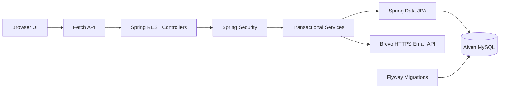

<div align="center">
  
  <h1>Aurelia Library</h1>
  <p><strong>Thoughtful tools for everyday library operations.</strong></p>
  <p>A modern library workspace for books, readers, staff, and circulation—designed to feel calm, clear, and effortless.</p>
  <p>
    <a href="https://aurelia-library-management.onrender.com"></a>
    <a href="docs/ARCHITECTURE.md"></a>
    <a href="docs/DEPLOYMENT_FREE.md"></a>
  </p>
  <p>
    
    
    
    
    
  </p>
</div>

---

## Current application screenshots

These captures reflect the deployed Aurelia Library interface, including the workspace overview, book catalogue, and successful staff-onboarding flow.

<table>
  <tr>
    <td width="50%" valign="top"><a href="screenshots/current/overview-dashboard.jpg"></a><p align="center"><sub><strong>01 · Workspace overview</strong></sub></p></td>
    <td width="50%" valign="top"><a href="screenshots/current/book-collection.jpg"></a><p align="center"><sub><strong>02 · Book collection</strong></sub></p></td>
  </tr>
  <tr>
    <td colspan="2" align="center"><a href="screenshots/current/invitation-setup.jpg"></a><p align="center"><sub><strong>03 · Staff onboarding</strong></sub></p></td>
  </tr>
</table>

## The experience, at a glance

<table>
  <tr>
    <td width="33%" valign="top">
      <h3>📚 A living collection</h3>
      Search book titles and authors, manage catalogue details, and track availability as books are borrowed and returned.
    </td>
    <td width="33%" valign="top">
      <h3>👥 A connected community</h3>
      Keep student and librarian profiles organized with role-appropriate access to library operations.
    </td>
    <td width="33%" valign="top">
      <h3>↗ Thoughtful circulation</h3>
      Record loans, process returns, and preserve circulation history for library reporting.
    </td>
  </tr>
  <tr>
    <td width="33%" valign="top">
      <h3>🛡️ Built-in safeguards</h3>
      Session-based authentication, BCrypt password hashes, server-side validation, CSRF protection, and role-based authorization.
    </td>
    <td width="33%" valign="top">
      <h3>✉️ Staff onboarding</h3>
      Administrators invite librarians by email. One-time setup links let invited staff choose their own password.
    </td>
    <td width="33%" valign="top">
      <h3>✨ Calm, responsive UI</h3>
      Spacious layouts, soft gradients, layered panels, and dedicated navigation for desktop and mobile use.
    </td>
  </tr>
</table>

## Designed around three roles

| Administrator | Librarian | Student |
|---|---|---|
| Manage books, students, and librarians | Manage permitted catalogue and reader operations | Browse the catalogue and borrow available books |
| Invite staff and manage accounts | Record and complete circulation | View personal loans and account details |
| View dashboard and circulation history | Maintain reader details and circulation records | Manage personal profile and password |

Access is enforced by the backend; hiding a navigation item is not the security boundary.

## How it fits together



The frontend and REST API are served by the same Spring Boot application, keeping requests on one origin. Services handle business rules and transactional operations; Flyway versions schema changes, and Hibernate validates the mapped schema at startup.

## Technology stack

<table>
  <tr><th align="left">Layer</th><th align="left">Technology</th></tr>
  <tr><td>Runtime and backend</td><td>Java 21 · Spring Boot 3.5 · Spring MVC</td></tr>
  <tr><td>Security</td><td>Spring Security 6.5 · BCrypt · session authentication · CSRF protection</td></tr>
  <tr><td>Persistence</td><td>Spring Data JPA · Hibernate · MySQL</td></tr>
  <tr><td>Schema management</td><td>Flyway migrations · Hibernate schema validation</td></tr>
  <tr><td>Frontend</td><td>HTML · CSS · JavaScript · Fetch API</td></tr>
  <tr><td>Email</td><td>Brevo HTTPS transactional email API; SMTP for local development</td></tr>
  <tr><td>Build, deployment, tests</td><td>Maven Wrapper · Docker · Render · JUnit 5 · MockMvc · H2</td></tr>
</table>

## Live deployment

<table>
    <tr><th>Component</th><th>Hosted service</th></tr>
    <tr><td>Web app and API</td><td><a href="https://aurelia-library-management.onrender.com">Render</a></td></tr>
    <tr><td>Persistent database</td><td>Aiven MySQL</td></tr>
    <tr><td>Librarian invitation email</td><td>Brevo transactional API over HTTPS</td></tr>
</table>
  <p><a href="https://aurelia-library-management.onrender.com"><strong>↗ Open the live application</strong></a></p>

This is a portfolio/demo deployment on free tiers. Render may spin the service down after inactivity, and the free Aiven database may power down after extended inactivity. Invitation delivery depends on sender/provider policies and authentication. See the [deployment guide](docs/DEPLOYMENT_FREE.md) for setup and operational limitations.

## Run locally

<details>
  <summary><strong>Prerequisites and setup</strong></summary>

  **Prerequisites:** Java 21+, MySQL, and Git.

  ### 1. Clone the repository

  ```bash
  git clone https://github.com/priyanshuranjan02/Aurelia-Library.git
  cd Aurelia-Library
  ```

  ### 2. Configure MySQL and the initial administrator

  ```bash
  export LMS_DB_URL='jdbc:mysql://localhost:3306/librarydb?createDatabaseIfNotExist=true&useSSL=false&serverTimezone=UTC'
  export LMS_DB_USERNAME='your_mysql_user'
  export LMS_DB_PASSWORD='your_mysql_password'
  export LMS_BOOTSTRAP_ADMIN_USERNAME='admin'
  export LMS_BOOTSTRAP_ADMIN_PASSWORD='choose-a-strong-unique-password'
  ```

  Replace the example values with your own local credentials. Never commit passwords, API keys, or populated environment files.

  The bootstrap administrator is created only if both bootstrap variables are set and the username does not already exist. Its password is stored as a BCrypt hash; the bootstrap setting does not reset an existing account's password.

  ### 3. Start the application

  ```bash
  ./mvnw spring-boot:run
  ```

  Open [http://localhost:8080](http://localhost:8080).

  Flyway manages schema creation and migrations. For more details, see [Setup](docs/SETUP.md).
</details>

## Quality checks

Run the automated test suite from the repository root:

```bash
./mvnw clean test
```

The deployment-preparation test run completed with **19 tests, 0 failures, and 0 errors**. Tests use H2 in MySQL compatibility mode and cover authentication, authorization, CRUD, validation, CSRF handling, profile management, invitation integration, and circulation safeguards.

See [Testing](docs/TESTING.md) for the test strategy and details.

## API quick reference

| Endpoint | Purpose |
|---|---|
| `/api/auth` | CSRF bootstrap, login, logout, and current session |
| `/api/books` | Search and manage the book catalogue |
| `/api/students` | Student profile management |
| `/api/librarians` | Librarian management and invitation workflows |
| `/api/borrow-records` | Borrowing, returns, and circulation history |
| `/api/dashboard` | Role-specific dashboard information |
| `/api/profile` | Current-user profile and account management |

Full endpoint details, roles, response formats, and error codes are documented in [docs/API.md](docs/API.md).

## Explore the project

<table>
  <tr>
    <td width="50%" valign="top"><strong>📐 Architecture</strong><br><a href="docs/ARCHITECTURE.md">Architecture and decisions</a><br><a href="docs/PROJECT_STRUCTURE.md">Project structure</a><br><a href="docs/REQUIREMENTS.md">Requirements</a></td>
    <td width="50%" valign="top"><strong>🧰 Developer guides</strong><br><a href="docs/API.md">API contract</a><br><a href="docs/SETUP.md">Local setup</a><br><a href="docs/TESTING.md">Testing</a><br><a href="docs/CHANGELOG.md">Changelog</a></td>
  </tr>
  <tr>
    <td width="50%" valign="top"><strong>🚀 Deployment</strong><br><a href="docs/DEPLOYMENT_FREE.md">Free-tier deployment guide</a></td>
    <td width="50%" valign="top"><strong>🖼️ Current UI screenshots</strong><br><a href="screenshots/current/overview-dashboard.jpg">Workspace overview</a><br><a href="screenshots/current/book-collection.jpg">Book collection</a><br><a href="screenshots/current/invitation-setup.jpg">Staff onboarding</a></td>
  </tr>
</table>

<details>
  <summary><strong>Current screenshot index</strong></summary>

  [Workspace overview](screenshots/current/overview-dashboard.jpg) · [Book collection](screenshots/current/book-collection.jpg) · [Staff onboarding](screenshots/current/invitation-setup.jpg)
</details>

## Next ideas

Possible future extensions include pagination, advanced search, categories, fines, notifications, reservations, physical-copy modelling, and JWT-based API access.

---

<div align="center">
  <strong>Aurelia Library</strong><br>
  <sub>Make room for curiosity ✦</sub>
</div>
